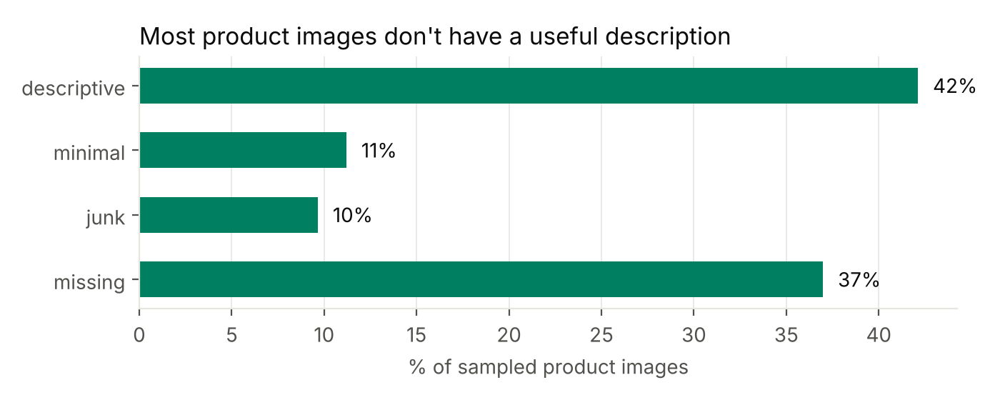
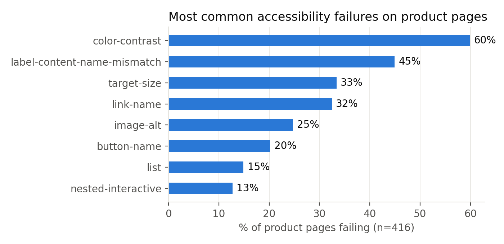
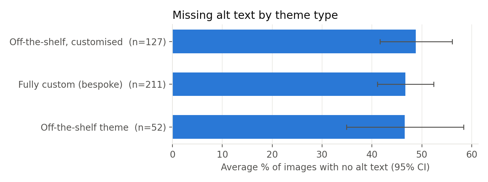

# Unseen: Measuring and Fixing Accessibility Gaps Across Shopify Stores

I audited **422 real Shopify stores** to measure how accessible they are for shoppers with disabilities, found what drives the biggest gap (missing image descriptions), and built **Ramp**, a working prototype that audits a Shopify store and fixes its image descriptions, benchmarked against my research.

**The headline:** the typical Shopify store leaves **47% of its product images with no description**, so a blind shopper using a screen reader hears nothing about what the product looks like.

🎥 **[Watch the 3-minute demo](#)** · 📄 **[Read the product memo](MEMO.md)**

---

## The question

Accessibility issues lock out shoppers with disabilities and expose small merchants to growing legal risk in the US and EU. I wanted to know:

1. How common are accessibility barriers on Shopify stores, and who do they affect?
2. What explains which stores have them: theme, store size, or something else?
3. Can AI fix the biggest gap reliably enough to build into a product like Shopify Magic?

## Data

| Source | What I collected | Size |
|---|---|---|
| Store product feeds (`/products.json`) | Products, descriptions, colour options, theme name | 422 stores, 75,110 products |
| Single-product data (`/products/<handle>.js`) | Real alt text for 10 random products per store (seed 42) | 401 stores, 30,661 images |
| Live page checks (Playwright + axe-core) | WCAG violations on each store's homepage and one product page | 838 pages |

**Sample:** 500 candidate stores (250 well-known brands, 250 smaller merchants from curated category lists). 422 returned data; every exclusion reason is logged (mostly feeds that were removed or blocked).

**A validation that changed the project:** I first assumed a missing `alt` field in the bulk product feed meant "no alt text." Checking a second source showed the bulk feed *never* includes alt text: 2,106 of 3,662 images I would have counted as missing actually had descriptions. I switched to the single-product source before analysing anything.

## Findings

**1. Most product images aren't usefully described.** I classified every image's alt text as *missing*, *junk* (file names, internal codes like `PDP2 Option[...] MAIN`), *minimal* (3 words or fewer), or *descriptive*.

| | Share of images |
|---|---|
| Descriptive | 42.1% |
| Minimal | 11.2% |
| Junk | 9.7% |
| Missing | 37.0% |

Averaged per store (the store is the unit Shopify would act on), the typical store is missing descriptions on **46.6% of images (95% CI 42.5 to 50.7%)**, and **46%** of stores are missing half or more. Only 22% have none missing.



**2. Barriers affect many groups of shoppers.** Share of stores with at least one automatically detected barrier:

| Who is affected | Stores |
|---|---|
| Blind shoppers (screen readers) | 85% |
| Low-vision and older shoppers (low contrast text) | 67% |
| Shoppers with tremors or no mouse (small tap targets) | 56% |
| Voice-control users (mismatched button labels) | 50% |
| Low-vision shoppers who need to zoom (zoom blocked) | 10% |



**3. It's a merchant habit, not a theme problem.** With 12 stores, off-the-shelf themes looked twice as good. With 52, the effect disappeared. A regression on 390 stores (theme type, store size, brand vs. smaller merchant, category) found **no significant predictors** (all p > 0.4, R² = 0.09). Missing alt text depends on whether each merchant writes descriptions, so the fix belongs in the **content workflow**, not the theme.



Also: handmade (75%), art (72%) and watches (70%) stores miss the most descriptions, exactly where the photo carries the product. Only 35% of product descriptions read as plain English.

## Ramp: the prototype

Ramp is an **MCP server** that connects Claude to a Shopify store through the Admin API. A merchant asks *"audit my store and fix the image descriptions"* and Ramp:

1. **Audits** the store with the same 4-level classifier from my research and benchmarks it: *"This store has more missing descriptions than 52% of the 401 stores studied."*
2. **Shows Claude the images** that need descriptions, so it can draft them.
3. **Saves approved descriptions** into Shopify and logs every change.

It's a prototype of what an accessibility feature in Shopify Magic or Sidekick could look like. It is not part of either product.

### Is the AI good enough? (evaluation)

I generated descriptions for **100 real images merchants had left undescribed** (one per store, 100 stores) and hand-scored each one.

| Measure | Result (95% CI) |
|---|---|
| Accurate | 97/100 (91.5 to 99.0%) |
| Useful to a blind shopper | 98/100 (93.0 to 99.4%) |
| Concise (under 125 characters) | 100/100 |
| No issue of any kind | 91/100 (83.8 to 95.2%) |

Errors clustered on **busy images**: printed text the AI skipped, several products summarised instead of named, and a few colour mistakes. So AI descriptions should be **suggested for merchant approval**, not published automatically.

*Limitations: one rater; descriptions from one model family.*

### Testing it (A/B test design + simulation)

Only Shopify can randomise real merchants, so I designed the test and checked it by simulation using the real store data (`analysis/step5_ab_test.ipynb`):

- **Design:** randomise by merchant; primary metric = share of a store's images with descriptive alt text after 30 days; guardrail = time to publish a product.
- **Sample size:** the standard formula says about 1,000 merchants per group to detect a 5-point lift.
- **The simulation showed that's not enough with a plain t-test:** power was only **62%**, because stores are extremely spread out (31% at 0%, 11% at 100%).
- **Adjusting for each merchant's pre-test coverage (CUPED)** raised power to **100%** with the same sample, with false alarms at 6% (expected about 5%).

| 1,000 simulated experiments | Plain t-test | CUPED |
|---|---|---|
| Detects a real 5-point lift | 62% | 100% |
| False alarms when there's no effect | 6% | 6% |


## Recommendation

Add AI image descriptions to **Shopify Magic**, offered at the moment a merchant uploads a product image, with an approval step and an extra prompt to review images that contain text or several items. Validate it with an A/B test analysed with CUPED (details in the [memo](MEMO.md)).

## Limitations

- Automated checks catch only some accessibility issues; results are "issues detected automatically," not compliance audits.
- Stores came from curated lists, which lean toward well-designed stores; a random sample of all Shopify stores would likely look worse.
- Readability scores only work for English.

## Repo structure

```
scrape_products.py   Step 1: product feeds + theme names
fetch_alt.py         Step 1: real alt text (10 random products per store)
page_check.py        Step 1: axe-core checks on 2 pages per store
build_tables.py      Step 2: clean tables for BigQuery
analysis/
  step3_measure.sql  Step 3: BigQuery SQL (classification view, CIs, window functions)
  step4_compare.ipynb Step 4: group comparisons, regression, charts
  step5_ab_test.ipynb Step 5: A/B test sizing + simulation (CUPED)
ramp/
  server.py          The MCP server (audit, find images, save fixes, evaluation tools)
  benchmark.json     Store-level benchmark from the research
  ai_descriptions.csv  100 AI descriptions + hand scores
data/tables/         Clean CSV tables
```

## Run it yourself

**Reproduce the research:**
```bash
python3 scrape_products.py && python3 fetch_alt.py
pip3 install playwright && python3 -m playwright install chromium
python3 page_check.py && python3 build_tables.py
```
Then load `data/tables/*.csv` into BigQuery and run `analysis/step3_measure.sql`, or open `analysis/step4_compare.ipynb`.

**Run Ramp on your own Shopify dev store:**
1. Create a free dev store and an app in the [Shopify Dev Dashboard](https://dev.shopify.com/dashboard) with scopes `read_products,write_products,read_files,write_files`, then install it on your store.
2. Copy `.env.example` to `.env` and add your store address, Client ID and Client secret.
3. Install [uv](https://docs.astral.sh/uv/) and test the connection: `uv run --script ramp/server.py --test`
4. Add Ramp to Claude Desktop's `claude_desktop_config.json`:
```json
"mcpServers": {
  "ramp": { "command": "/path/to/uv", "args": ["run", "--script", "/path/to/ramp/server.py"] }
}
```
5. Restart Claude Desktop and ask: *"Audit my store's accessibility."*

---
Built by Lalithya Raavi · [lalithya-website.vercel.app](https://lalithya-website.vercel.app)
