# ♿🛍 Ramp: Accessibility Copilot for Shopify (MCP Server)

Ramp is a Claude-powered accessibility copilot for Shopify merchants. It audits a store against research on **422 real Shopify stores**, finds the barriers that shut shoppers out, like missing or junk image descriptions and hard-to-read product text, and writes and saves AI image descriptions through the Shopify Admin API, all wired through a Model Context Protocol (MCP) server. A working prototype of what accessibility could look like in **Shopify Magic**.

> 🎥 **[Watch the demo video](#)** ← *See Ramp audit and fix a store*
>
> 📄 **[Read the product memo](MEMO.md)** ← *The case for Shopify Magic, plus the A/B test*

---

## 🔍 Why I Built This

**Many Shopify stores aren't built for every shopper.** Across 422 stores, I found barriers for blind shoppers, low-vision and older shoppers, people with tremors, and voice-control users.

The biggest single gap is **image descriptions**: the typical store leaves **47%** of its product images undescribed. Anyone relying on a screen reader gets no picture of the product, and the same descriptions help search engines and AI shopping agents understand it too.

I scraped 500 Shopify stores to measure how big these barriers are, who they affect, and what causes them. Then I built Ramp to fix the biggest one.

---

## 🧭 How It Works

```mermaid
flowchart LR
    A["🕸️ Web Scraping<br/><i>Python · 500 stores</i>"] --> B["✅ Data Validation<br/><i>caught a missing field</i>"]
    B --> C["🧹 Data Cleaning<br/><i>pandas · 6 tables</i>"]
    C --> D["🗄️ SQL Analysis<br/><i>BigQuery · CTEs, window functions</i>"]
    D --> E["📈 Statistics<br/><i>confidence intervals · regression</i>"]
    E --> F["🛠️ Ramp MCP Tool<br/><i>Shopify Admin API</i>"]
    F --> G["🎯 AI Evaluation<br/><i>100 hand-scored descriptions</i>"]
    G --> H["🧪 A/B Test Design<br/><i>power simulation · CUPED</i>"]

    classDef data fill:#e3f1df,stroke:#008060,color:#004c3f
    classDef build fill:#008060,stroke:#004c3f,color:#ffffff
    class A,B,C,D,E data
    class F,G,H build
```



| Stage | Skills | Where |
|---|---|---|
| 🕸️ Collect | Web scraping, APIs, ethical scraping (robots.txt, rate limits) | `scrape_products.py`, `fetch_alt.py`, `page_check.py` |
| ✅ Validate | Data validation, checking a source against a second one | `scrape_products.py` |
| 🧹 Clean | Data modelling, handling NULLs, filtering placeholders | `build_tables.py` |
| 🗄️ Measure | SQL: joins, CTEs, window functions, views | `analysis/step3_measure.sql` |
| 📈 Explain | Confidence intervals, group comparisons, regression | `analysis/step4_compare.ipynb` |
| 🛠️ Build | Python, MCP server, Shopify Admin API | `ramp/server.py` |
| 🎯 Evaluate | Metric design, measuring AI quality | `ramp/ai_descriptions.csv` |
| 🧪 Experiment | A/B test design, power analysis, simulation, CUPED | `analysis/step5_ab_test.ipynb` |

---

## 📊 Research Findings

#### 🖼️ Most product images aren't usefully described
- **42%** descriptive · **11%** minimal · **10%** junk (file names, internal codes like `PDP2 Option[...] MAIN`) · **37%** missing
- The typical store is missing descriptions on **46.6%** of images *(95% CI: 42.5 to 50.7%)*
- Worst categories: **handmade (75%)**, **art (72%)**, **watches (70%)**, exactly where the photo sells the product


#### 👥 Barriers affect many shoppers (share of stores with at least one)
- 🦯 **85%** block blind shoppers (screen readers)
- 👓 **67%** have text too faint for low-vision and older shoppers
- ✋ **56%** have buttons too small for shoppers with tremors
- 🎙️ **50%** confuse voice-control users
- 🔎 **10%** block zooming entirely


#### 🧩 It's a merchant habit, not a theme problem
- With 12 stores, off-the-shelf themes looked twice as good. With 52, the effect **disappeared**.
- A regression on 390 stores (theme, store size, brand vs. small merchant, category) found **no significant predictors** *(all p > 0.4, R² = 0.09)*
- So the fix belongs in the **content workflow**, where merchants add products, not in themes.

---

## 🛠️ Ramp Tools (5 Total)

Each tool runs on the Ramp MCP server and is callable by Claude.

#### 🏬 Merchant Tools
- `audit_store`: accessibility report card, benchmarked against 401 researched stores
- `get_images_needing_alt`: shows Claude the images with missing or junk descriptions
- `update_image_alt`: saves an approved description to Shopify and logs the change

#### 🧪 Evaluation Tools
- `get_research_images`: serves 100 real undescribed images (1 per store) for testing
- `save_ai_description`: records AI descriptions for hand-scoring

---

## ✅ Is the AI Good Enough?

I generated descriptions for **100 real images merchants had left blank** and hand-scored every one.

- 🎯 **97%** accurate *(95% CI: 91.5 to 99.0%)*
- 💡 **98%** useful to a blind shopper
- ✂️ **100%** concise (under 125 characters)
- ⚠️ **9%** had some issue, mostly on busy images (skipped printed text, several products summarised, a few colour mistakes)

**Takeaway:** AI should *suggest* descriptions for merchants to approve, not publish them automatically.

---

## 🧪 A/B Test Design

Only Shopify can randomise real merchants, so I designed the test and **checked it by simulation** on the real store data.

- **Randomise by merchant** · **Metric:** % of images with descriptive alt text after 30 days · **Guardrail:** time to publish a product
- The standard formula says **~1,000 merchants per group** to detect a 5-point lift
- **The simulation showed that's not enough:** a plain t-test caught the lift only **62%** of the time
- Adjusting for each merchant's pre-test coverage (**CUPED**) raised that to **100%**, with false alarms still at the expected level (6%)


---

## 🚀 Setup Guide

### 1. Clone the Repo
```bash
git clone https://github.com/lalithyaraavi/ramp-shopify-accessibility.git
cd ramp-shopify-accessibility
```

### 2. Create a Shopify Dev Store and App
In the [Shopify Dev Dashboard](https://dev.shopify.com/dashboard), create a free dev store and an app with these scopes, then install it on your store:
```
read_products,write_products,read_files,write_files
```

### 3. Add Your Credentials
Copy `.env.example` to `.env` and fill it in:
```
SHOPIFY_STORE=your-store.myshopify.com
SHOPIFY_CLIENT_ID=your-client-id
SHOPIFY_CLIENT_SECRET=your-client-secret
```

### 4. Test the Connection
Install [uv](https://docs.astral.sh/uv/), then:
```bash
uv run --script ramp/server.py --test
```

### 5. Connect to Claude Desktop
Add this to your `claude_desktop_config.json`, then restart Claude Desktop:
```json
"mcpServers": {
  "ramp": {
    "command": "/path/to/uv",
    "args": ["run", "--script", "/path/to/ramp/server.py"]
  }
}
```

---

## 🕹 Example Prompts to Try

- "Audit my store's accessibility."
- "Show me the images that need descriptions."
- "Write descriptions for these and save the ones I approve."
- "How does my store compare to other Shopify stores?"

---

## 🔬 Reproduce the Research

```bash
python3 scrape_products.py     # product feeds + theme names
python3 fetch_alt.py           # real alt text, 10 random products per store
pip3 install playwright && python3 -m playwright install chromium
python3 page_check.py          # axe-core checks on 2 pages per store
python3 build_tables.py        # clean tables for BigQuery
```

- `analysis/step3_measure.sql`: BigQuery SQL (classification view, confidence intervals, window functions)
- `analysis/step4_compare.ipynb`: group comparisons, regression, charts
- `analysis/step5_ab_test.ipynb`: A/B test sizing and simulation

**A validation that changed the project:** Shopify's bulk product feed *never* includes alt text. I caught this by checking a second source. Without that check, every store would have looked like it had zero image descriptions.

---

## ⚠️ Limitations

- Automated checks catch only some accessibility issues ("issues detected automatically," not compliance audits)
- Stores came from curated lists, which lean toward well-designed stores
- AI evaluation used one rater and one model family
- Ramp is an independent prototype, not part of Shopify Magic or Sidekick

---

## 💬 Questions or Feedback?

Built by **Lalithya Raavi** · [lalithya-website.vercel.app](https://lalithya-website.vercel.app)
