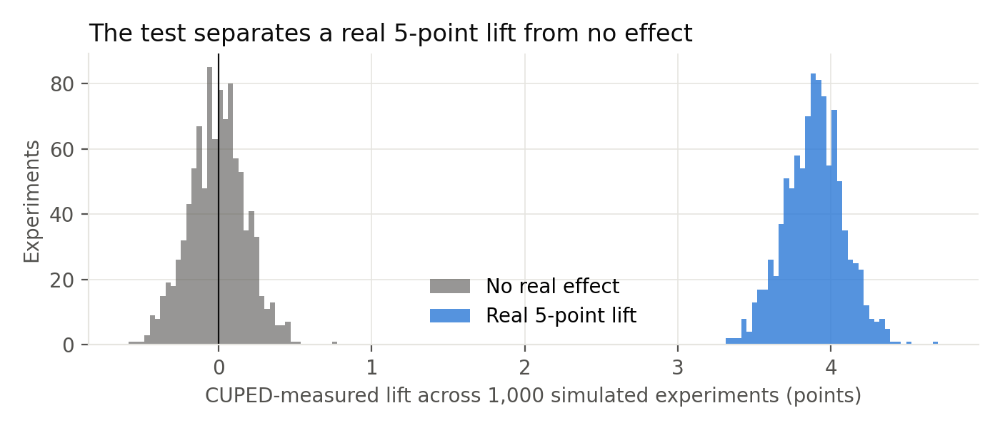

# 🛍️ How Accessible Are Shopify Stores?

### A 422-store study, and Ramp: Shopify Magic, extended to accessibility

I studied 422 Shopify stores and found that **the typical store leaves 47% of its product images undescribed**: invisible to screen readers, search engines and AI shopping agents. Then I built **Ramp**, a prototype that extends what Shopify Magic does today (writing product content) to accessibility: it audits a store against this research and writes the missing image descriptions for the merchant to approve.

🎥 **[Demo video](#)** · 📄 **[Product memo](MEMO.md)**

---

## 🔍 The problem

Many Shopify stores aren't built for every shopper. I found barriers for blind shoppers, low-vision and older shoppers, people with tremors, and voice-control users.

The biggest single gap is **image descriptions** (alt text). Without them, anyone using a screen reader gets no picture of the product, and search engines and AI shopping agents understand it less too.

I wanted to answer three questions:
1. How common are these barriers, and who do they affect?
2. What explains which stores have them?
3. Can AI fix the biggest gap reliably enough to build into a product?

---

## 💼 Why this matters to Shopify

Shopify grows when its merchants sell more and stay on Shopify. Missing image descriptions get in the way of that:

- ⚖️ **Legal risk for merchants:** most e-commerce accessibility lawsuits in 2025 targeted companies with under $25M in revenue, Shopify's core base.[^1] A lawsuit can push a small merchant off the platform.
- 🇪🇺 **Selling in Europe:** the European Accessibility Act has been enforced since June 2025.[^2]
- 🤖 **AI shopping agents:** agents rely on structured product information, not photos.[^3] An undescribed image is close to invisible to them, as Shopify bets on agentic commerce.
- 🛒 **More shoppers who can buy:** every shopper who can't use a store is a lost sale.

> **What this project does *not* claim:** that fixing alt text increases sales. That's what the A/B test below is designed to measure.

---

## 🧭 How I did it


| Stage | Skills | Where to look |
|---|---|---|
| Collect | Web scraping, APIs, ethical scraping (robots.txt, rate limits) | `scrape_products.py`, `fetch_alt.py`, `page_check.py` |
| Validate | Checking a data source against a second one | `scrape_products.py` |
| Clean | Data modelling, handling NULLs, filtering placeholders | `build_tables.py` |
| Measure | SQL: joins, CTEs, window functions, views | `analysis/step3_measure.sql` |
| Explain | Confidence intervals, group comparisons, regression | `analysis/step4_compare.ipynb` |
| Build | Python, MCP server, Shopify Admin API | `ramp/server.py` |
| Evaluate | Metric design, measuring AI quality | `ramp/ai_descriptions.csv` |
| Experiment | A/B test design, power analysis, simulation, CUPED | `analysis/step5_ab_test.ipynb` |

**The data:** 500 candidate stores (250 well-known brands, 250 smaller merchants). 422 returned data, giving 75,110 products, 30,661 sampled images (10 random products per store) and 838 pages checked with axe-core. Every excluded store has a logged reason.

**A check that changed the project:** I first assumed a missing alt field in Shopify's bulk product feed meant "no description." Checking a second source showed the bulk feed *never* includes alt text: 2,106 of 3,662 images I would have counted as missing actually had descriptions. I switched sources before analysing anything.

---

## 📊 What I found

#### 🖼️ 1. Most product images aren't usefully described
I classified the alt text of 30,661 product images from 401 stores:
- **42%** descriptive
- **11%** minimal (3 words or fewer)
- **10%** junk (file names, internal codes like `PDP2 Option[...] MAIN`)
- **37%** missing

Averaged per store, the typical store is missing descriptions on **46.6%** of images *(95% CI: 42.5 to 50.7%)*. Handmade (75%), art (72%) and watches (70%) stores miss the most, exactly where the photo sells the product.


#### 👥 2. Barriers affect many groups of shoppers
Share of stores with at least one automatically detected barrier:
- 🦯 **85%** for screen-reader users
- 👓 **67%** for low-vision and older shoppers (text too faint)
- ✋ **56%** for shoppers with tremors (buttons too small)
- 🎙️ **50%** for voice-control users
- 🔎 **10%** block zooming entirely


#### 🧩 3. It's a merchant habit, not a theme problem
With 12 stores, off-the-shelf themes looked twice as good. With 52, the effect disappeared. A regression on 390 stores (theme, store size, brand vs. smaller merchant, category) found no significant predictors *(all p > 0.4, R² = 0.09)*. So the fix belongs where merchants add products, not in themes.

---

## ✨ Ramp: Shopify Magic, extended to accessibility

Shopify Magic already writes product descriptions, email subject lines and blog posts for merchants, but not image descriptions.[^4] Ramp prototypes that missing piece, backed by the research. It connects Claude to a Shopify store through the Admin API, using an MCP server. A merchant asks *"audit my store and fix the image descriptions,"* and Ramp:

1. **Audits** the store with the same classifier from the research, and compares it to the 401 stores: *"This store has more missing descriptions than 52% of stores studied."*
2. **Shows Claude the images** that need descriptions, so it can draft them.
3. **Saves the descriptions the merchant approves** to Shopify, and logs every change.

#### 🛠️ Tools
- `audit_store`: accessibility report, benchmarked against the research
- `get_images_needing_alt`: images with missing or junk descriptions
- `update_image_alt`: saves an approved description to Shopify
- `get_research_images`, `save_ai_description`: used for the AI evaluation below

---

## ✅ Is the AI good enough?

I generated descriptions for **100 real images merchants had left blank** (one per store) and scored each one by hand.

- 🎯 **97%** accurate *(95% CI: 91.5 to 99.0%)*
- 💡 **98%** useful to someone who can't see the image
- ✂️ **100%** concise (under 125 characters)
- ⚠️ **9%** had some issue, mostly on busy images: skipped printed text, several products summarised, a few colour mistakes

So AI should **suggest** descriptions for merchants to approve, not publish them automatically.

---

## 🧪 How Shopify could test it

Only Shopify can randomise real merchants, so I designed the A/B test and checked it by simulation on the real store data.

- **Design:** randomise by merchant, run for 4+ weeks.
- **Primary metric:** share of images with descriptive alt text after 30 days (what the feature directly changes).
- **Business metrics:** conversion rate on fixed products, and traffic from search and AI shopping agents. This is how Shopify would learn whether it drives sales.
- **Guardrail:** time to publish a product.
- **Sample size:** the standard formula says about 1,000 merchants per group to detect a 5-point lift.
- **The simulation showed that isn't enough:** a plain t-test caught the lift only 62% of the time, because stores are so spread out (31% at 0%, 11% at 100%).
- **The fix:** adjusting for each merchant's coverage before the test (CUPED) raised that to 100%, with false alarms still at the expected level (6%).



---

## 🚀 Try it yourself

#### Run Ramp on your own Shopify dev store

1. Clone the repo:
   ```bash
   git clone https://github.com/lalithyaraavi/ramp-shopify-accessibility.git
   cd ramp-shopify-accessibility
   ```
2. In the [Shopify Dev Dashboard](https://dev.shopify.com/dashboard), create a free dev store and an app with the scopes `read_products,write_products,read_files,write_files`, then install it on your store.
3. Copy `.env.example` to `.env` and add your store address, Client ID and Client secret.
4. Install [uv](https://docs.astral.sh/uv/) and test the connection:
   ```bash
   uv run --script ramp/server.py --test
   ```
5. Add Ramp to Claude Desktop's `claude_desktop_config.json`, then restart Claude Desktop:
   ```json
   "mcpServers": {
     "ramp": { "command": "/path/to/uv", "args": ["run", "--script", "/path/to/ramp/server.py"] }
   }
   ```
6. Ask Claude: *"Audit my store's accessibility."*

#### Rerun the research
```bash
python3 scrape_products.py     # product feeds and theme names
python3 fetch_alt.py           # real alt text, 10 random products per store
pip3 install playwright && python3 -m playwright install chromium
python3 page_check.py          # axe-core checks on 2 pages per store
python3 build_tables.py        # clean tables for BigQuery
```
Then run `analysis/step3_measure.sql` in BigQuery, or open the notebooks in `analysis/`.

---

## ⚠️ Limitations

- Automated checks catch only some accessibility issues, so these are "issues detected automatically," not compliance audits.
- Stores came from curated lists, which lean toward well-designed stores.
- The AI evaluation used one rater and one model family.
- Ramp is an independent prototype, not part of Shopify Magic or Sidekick.

---

Built by **Lalithya Raavi** · [lalithya-website.vercel.app](https://lalithya-website.vercel.app)

[^1]: [KEYT / Stacker: Accessibility lawsuits rose 37% in 2025](https://keyt.com/news/money-and-business/stacker-money/2026/01/14/accessibility-lawsuits-rose-by-37-in-2025-why-small-businesses-can-no-longer-ignore-their-websites/)
[^2]: [TestParty: Shopify digital accessibility guide](https://testparty.ai/blog/the-complete-guide-to-shopify-digital-accessibility-what-every-e-commerce-store-o)
[^3]: [ChannelEngine: Ecommerce predictions 2026](https://www.channelengine.com/en/blog/ecommerce-predictions)
[^4]: [Shopify Help Center: Shopify Magic](https://help.shopify.com/manual/shopify-admin/productivity-tools/shopify-magic)
