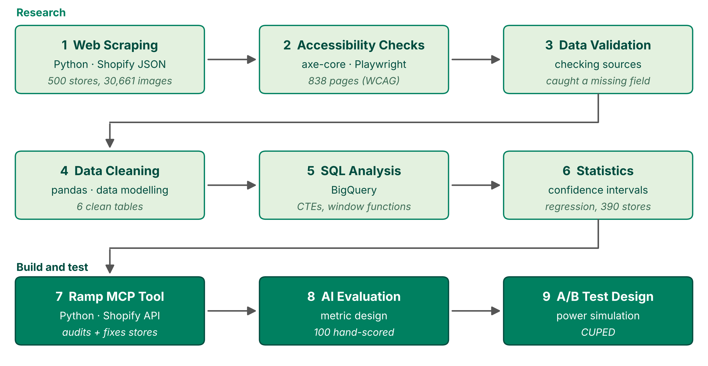
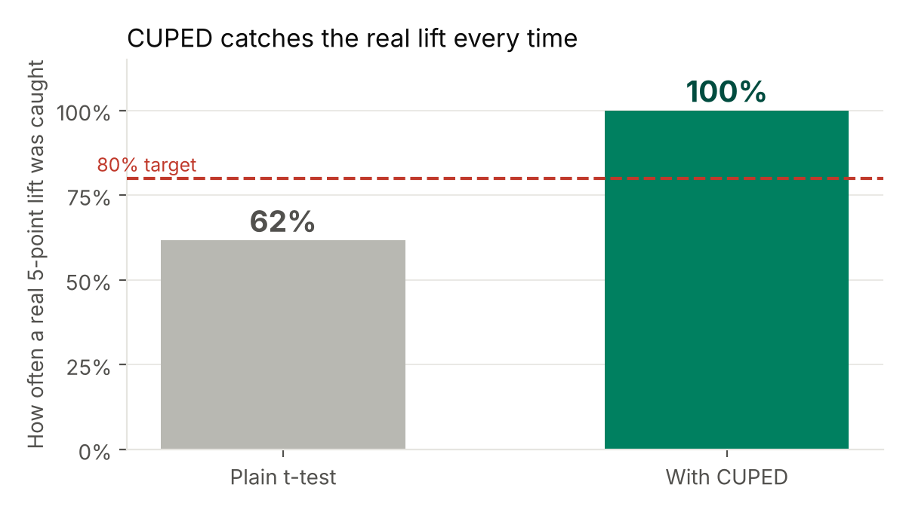

# 🛍️♿ How Accessible Are Shopify Stores?

### Measuring accessibility across 422 Shopify stores, and extending Shopify Sidekick to close the gap

I studied 422 Shopify stores and found that **the typical store leaves 47% of its product images undescribed**: invisible to screen readers, search engines and AI shopping agents. Then I built **AltWise**, a prototype that extends Shopify Sidekick to accessibility: it audits a store against this research and writes the missing image descriptions for the merchant to approve.

🎥 **[Demo video](#)** · 📄 **[Product memo](MEMO.md)**

**Contents:** [The problem](#-the-problem) · [Why it matters](#-why-this-matters-to-shopify) · [How I did it](#-how-i-did-it) · [What I found](#-what-i-found) · [AltWise](#-altwise-extending-shopify-sidekick-to-accessibility) · [AI evaluation](#-is-the-ai-good-enough) · [A/B test](#-how-shopify-could-test-it) · [What I learned](#-what-i-learned) · [Next steps](#-next-steps) · [Try it yourself](#-try-it-yourself)

---

## 🔍 The problem

Many Shopify stores aren't built for every shopper. I found barriers for blind shoppers, low-vision and older shoppers, people with tremors, and voice-control users.

The biggest single gap is **image descriptions** (alt text). Without them, anyone using a screen reader gets no picture of the product, and search engines and AI shopping agents understand it less too.

I wanted to answer three questions:
1. How common are these barriers, and who do they affect?
2. What explains which stores have them?
3. Can AI fix the biggest gap reliably enough to build into a product?

---

## 💼 Why this matters to Shopify

Shopify grows when its merchants sell more and stay on Shopify. Missing image descriptions get in the way of that:

- ⚖️ **Legal risk for merchants:** most e-commerce accessibility lawsuits in 2025 targeted companies with under $25M in revenue, Shopify's core base.[^1] A lawsuit can push a small merchant off the platform.
- 🇪🇺 **Selling in Europe:** the European Accessibility Act has been enforced since June 2025.[^2]
- 🤖 **AI shopping agents:** agents rely on structured product information, not photos.[^3] An undescribed image is close to invisible to them, as Shopify bets on agentic commerce.
- 🛒 **More shoppers who can buy:** every shopper who can't use a store is a lost sale.

> **What this project does *not* claim:** that fixing alt text increases sales. That's what the A/B test below is designed to measure.

---

## 🧭 How I did it



| Stage | Skills | Where to look |
|---|---|---|
| Collect | Web scraping, APIs, ethical scraping (robots.txt, rate limits) | `scrape_products.py`, `fetch_alt.py` |
| Check | Automated accessibility testing with axe-core (WCAG rules) in a headless browser (Playwright) | `page_check.py` |
| Validate | Checking a data source against a second one | `scrape_products.py` |
| Clean | Data modelling, handling NULLs, filtering placeholders | `build_tables.py` |
| Measure | SQL: joins, CTEs, window functions, views | `analysis/step3_measure.sql` |
| Explain | Confidence intervals, group comparisons, regression | `analysis/step4_compare.ipynb` |
| Build | Python, MCP server, Shopify Admin API | `altwise/server.py` |
| Evaluate | Metric design, measuring AI quality | `altwise/ai_descriptions.csv` |
| Experiment | A/B test design, power analysis, simulation, CUPED | `analysis/step5_ab_test.ipynb` |

**The data:** 500 candidate stores (250 well-known brands, 250 smaller merchants). 422 returned data, giving 75,110 products, 30,661 sampled images (10 random products per store) and 838 pages (a homepage and a product page per store) tested with **axe-core**, the industry-standard accessibility checker, which flags WCAG problems like low-contrast text, unlabeled buttons and small tap targets. Every excluded store has a logged reason.

**A check that changed the project:** I first assumed a missing alt field in Shopify's bulk product feed meant "no description." Checking a second source showed the bulk feed *never* includes alt text: 2,106 of 3,662 images I would have counted as missing actually had descriptions. I switched sources before analysing anything.

---

## 📊 What I found

#### 🖼️ 1. Most product images aren't usefully described
I classified the alt text of 30,661 product images from 401 stores:
- **42%** descriptive
- **11%** minimal (3 words or fewer)
- **10%** junk (file names, internal codes like `PDP2 Option[...] MAIN`)
- **37%** missing

Real examples of "junk" alt text a screen reader would read out loud:

| Alt text found | What it actually is |
|---|---|
| `PDP2 Option[Flamingo] LIFESTYLE` | An internal photo label |
| `Color:Ocean;` | A product option, not a description |
| `IMG_4821.jpg` | A file name |
| `#color_Phantom Blue` | A colour code |
| `natural-diamond` | A URL slug |

Averaged per store, the typical store is missing descriptions on **46.6%** of images *(95% CI: 42.5 to 50.7%)*. Handmade (75%), art (72%) and watches (70%) stores miss the most, exactly where the photo sells the product.


#### 👥 2. Barriers affect many groups of shoppers
Share of stores where axe-core detected at least one barrier:
- 🦯 **85%** for screen-reader users
- 👓 **67%** for low-vision and older shoppers (text too faint)
- ✋ **56%** for shoppers with tremors (buttons too small)
- 🎙️ **50%** for voice-control users
- 🔎 **10%** block zooming entirely


#### 🧩 3. It's a merchant habit, not a theme problem
With 12 stores, off-the-shelf themes looked twice as good. With 52, the effect disappeared. A regression on 390 stores (theme, store size, brand vs. smaller merchant, category) found no significant predictors *(all p > 0.4, R² = 0.09)*. So the fix belongs where merchants add products, not in themes.


---

## ✨ AltWise: extending Shopify Sidekick to accessibility

Sidekick, Shopify's AI assistant, already writes product descriptions and blog posts and edits products when a merchant asks.[^4] But it doesn't check a store's accessibility or point out images with no description. AltWise prototypes that missing feature, backed by the research. It works the way Sidekick does: a merchant chats with an AI assistant (Claude), which connects to the store through the Shopify Admin API using an MCP server.

#### 🔁 How it works
1. **🔔 It reminds the merchant, unprompted.** When a merchant uploads a product photo with no description, AltWise sends a notification with the store's accessibility score. Merchants forget, or don't know they should add descriptions, so the reminder has to come to them.
2. **📊 "Check in on my store"** (or *"Audit my store's accessibility"*) returns:
   - a **store accessibility score** out of 100, next to the average store from the research. It averages two parts, both measured exactly as in the research: **product images** (the share a screen reader can describe) and **pages** (the share of 5 shopper groups with no barriers when axe-core scans the live storefront);
   - **every image that needs a description**, newest first, with what a screen reader hears now and a suggested description;
   - **other ways to improve**, based on what the page scan found (for example, low colour contrast and where to fix it in the theme settings);
   - and one question: *"Want me to save these descriptions?"*
3. **✅ "Save them"** saves every approved description to Shopify in one step, logs each change, and shows the **new score** next to the old one.

Nothing is saved without the merchant's approval.

#### 🛠️ Tools
- `audit_store`: store accessibility score, a suggested description for every image that needs one, and recommendations
- `store_checkin`: the same, plus a note about photos uploaded in the last day (what the notification asks merchants to say)
- `save_descriptions`: saves all approved descriptions at once and returns the new score
- `scan_storefront`: runs axe-core on the live storefront (homepage + a product page)
- `--watch` mode: checks the store every 20 seconds and sends a desktop notification when a new photo has no description. In production this would use Shopify's product-created webhook instead, so the reminder fires instantly inside the admin.
- `update_image_alt`, `get_images_needing_alt`: single-image versions
- `get_research_images`, `save_ai_description`: used for the AI evaluation below

---

## ✅ Is the AI good enough?

I generated descriptions for **100 real images merchants had left blank** (one per store) and scored each one by hand.

- 🎯 **97%** accurate *(95% CI: 91.5 to 99.0%)*
- 💡 **98%** useful to someone who can't see the image
- ✂️ **100%** concise (under 125 characters)
- ⚠️ **9%** had some issue, mostly on busy images: skipped printed text, several products summarised, a few colour mistakes

Examples from the evaluation:

| Product | AI description | Verdict |
|---|---|---|
| Paperclip chain bracelet | "Rose gold paperclip chain bracelet with elongated links and a lobster clasp, laid in a circle on white" | ✅ Accurate and useful |
| Women's lace-up sneakers | "Pair of brick-red suede and canvas lace-up sneakers with cream laces and white soles" | ✅ Accurate and useful |
| Cereal treats variety pack | "Six Magic Spoon protein treat boxes in different flavours, each on a colourful background..." | ⚠️ Didn't name the flavours shown |
| Flower posy gift | "Native flower posy with pincushion protea and eucalyptus in a glass jar beside a kraft LVLY gift box" | ⚠️ Skipped the printed message on the box |

So AI should **suggest** descriptions for merchants to approve, not publish them automatically.

---

## 🧪 How Shopify could test it

Only Shopify can randomise real merchants, so I designed the A/B test and checked it by simulation on the real store data.

- **Design:** randomise by merchant, run for 4+ weeks.
- **Primary metric:** share of images with descriptive alt text after 30 days (what the feature directly changes).
- **Business metrics:** conversion rate on fixed products, and traffic from search and AI shopping agents. This is how Shopify would learn whether it drives sales.
- **Guardrail:** time to publish a product.
- **Sample size:** the standard formula says about 1,000 merchants per group to detect a 5-point lift.
- **The simulation showed that isn't enough:** a plain t-test caught the lift only 62% of the time, because stores are so spread out (31% at 0%, 11% at 100%).
- **The fix:** adjusting for each merchant's coverage before the test (CUPED) raised that to 100%, with false alarms still at the expected level (6%).



**Why CUPED works:** across 1,000 simulated experiments, the lift CUPED measured never overlaps between "no real effect" (around 0) and "real 5-point lift" (around 4; below 5 because some stores are already at 100%), so it tells them apart every time.


---

## 🧠 What I learned

- **Validate the data source before trusting it.** Shopify's bulk product feed never includes alt text. If I hadn't checked a second source, every store would have looked like it had zero image descriptions, and the headline would have been wrong.
- **Don't trust small samples.** With 12 stores, off-the-shelf themes looked twice as good. I expanded the sample, and with 52 stores the effect disappeared. That changed my recommendation from "fix themes" to "fix the content workflow."
- **The unit of analysis changes the answer.** Pooling all images gave 37% missing; averaging per store gave 47%, because image-heavy stores describe their images better. I report the store-level number, since the merchant is who Shopify would act on.
- **Check formulas against the real data.** The standard sample-size formula said 1,000 merchants per group was enough. Simulating the test on the real store data showed only 62% power. CUPED fixed it.
- **A metric needs more than yes/no.** "Has alt text" hides junk like `IMG_4821.jpg`. A four-level metric (missing, junk, minimal, descriptive) told the real story.

---

## 🔮 Next steps

- **Build it into Sidekick**: a Sidekick Pulse card that flags undescribed images, the same audit-and-fix flow in Sidekick chat, and a suggested description the moment a merchant uploads a product image.
- **Run the A/B test** from this project on real merchants to measure how many images get described and how often merchants accept the AI's suggestion.
- **Measure business impact** in the same test: conversion and traffic from search and AI shopping agents.
- **Use a random sample of Shopify stores** instead of curated lists, which likely understate the problem.
- **Add a second rater** for the AI evaluation and measure how often raters agree.
- **Share theme-level findings** (like colour contrast, which failed on 60% of product pages) with Shopify's theme team.

---

## 🚀 Try it yourself

#### Run AltWise on your own Shopify dev store

1. Clone the repo:
   ```bash
   git clone https://github.com/lalithyaraavi/altwise-shopify-accessibility.git
   cd altwise-shopify-accessibility
   ```
2. In the [Shopify Dev Dashboard](https://dev.shopify.com/dashboard), create a free dev store and an app with the scopes `read_products,write_products,read_files,write_files`, then install it on your store.
3. Copy `.env.example` to `.env` and add your store address, Client ID, Client secret and storefront password (for dev stores).
4. Install [uv](https://docs.astral.sh/uv/) and test the connection:
   ```bash
   uv run --script altwise/server.py --test
   ```
5. Add AltWise to Claude Desktop's `claude_desktop_config.json`, then restart Claude Desktop:
   ```json
   "mcpServers": {
     "altwise": { "command": "/path/to/uv", "args": ["run", "--script", "/path/to/altwise/server.py"] }
   }
   ```
6. Scan the storefront once for the page part of the score:
   ```bash
   uv run --script altwise/server.py --scan-pages
   ```
7. (Optional) Turn on proactive reminders in a separate terminal:
   ```bash
   uv run --script altwise/server.py --watch
   ```
8. Ask Claude: *"Check in on my store"* or *"Audit my store's accessibility,"* then *"Save them."*

#### Rerun the research
```bash
python3 scrape_products.py     # product feeds and theme names
python3 fetch_alt.py           # real alt text, 10 random products per store
pip3 install playwright && python3 -m playwright install chromium
python3 page_check.py          # axe-core checks on 2 pages per store
python3 build_tables.py        # clean tables for BigQuery
```
Then run `analysis/step3_measure.sql` in BigQuery, or open the notebooks in `analysis/`.

---

## ⚠️ Limitations

- Automated checks catch only some accessibility issues, so these are "issues detected automatically," not compliance audits.
- Stores came from curated lists, which lean toward well-designed stores.
- The AI evaluation used one rater and one model family.
- AltWise is an independent prototype, not part of Shopify Sidekick.

---

🛍️ **Made for Shopify by Lali** ❤️ · [lalithya-website.vercel.app](https://lalithya-website.vercel.app)

[^1]: [KEYT / Stacker: Accessibility lawsuits rose 37% in 2025](https://keyt.com/news/money-and-business/stacker-money/2026/01/14/accessibility-lawsuits-rose-by-37-in-2025-why-small-businesses-can-no-longer-ignore-their-websites/)
[^2]: [TestParty: Shopify digital accessibility guide](https://testparty.ai/blog/the-complete-guide-to-shopify-digital-accessibility-what-every-e-commerce-store-o)
[^3]: [ChannelEngine: Ecommerce predictions 2026](https://www.channelengine.com/en/blog/ecommerce-predictions)
[^4]: [Shopify Help Center: Sidekick](https://help.shopify.com/manual/shopify-admin/productivity-tools/sidekick)
